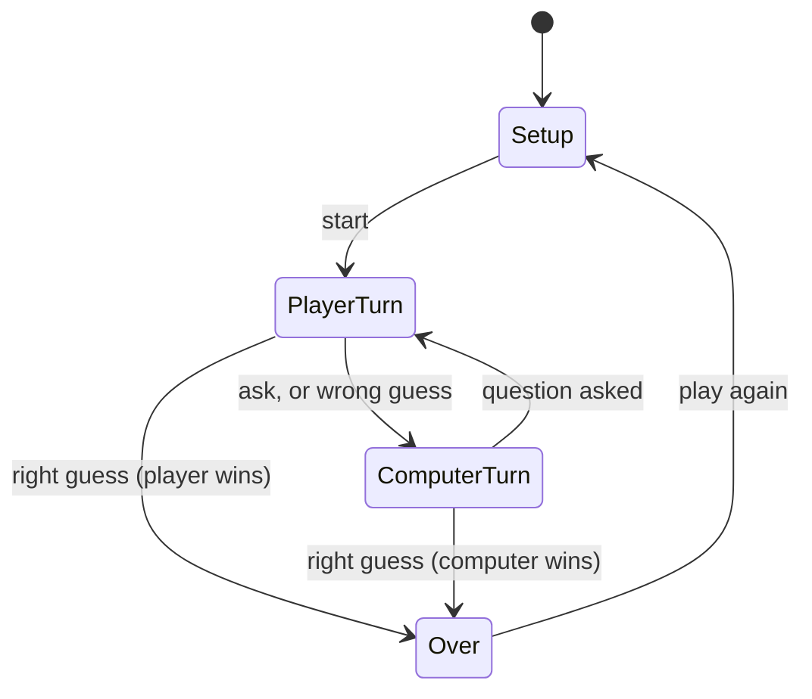

# Game spec

Status: draft for review · Owner: Medhini · Issue: #70 · Last updated: 2026-11-17

The rules, data format, computer opponent, interaction model and package API of the
game on `/play`. Every later game issue builds against this page. The concept, scope
and cut lines are decided in [ADR-0005](../adr/0005-deduction-game-with-board-packs.md);
the package boundaries in [ADR-0002](../adr/0002-monorepo-with-standalone-game-package.md).
The screens are in [`wireframes.md`](../design/wireframes.md#play-play).

## Decisions

Answers from the owner, and what is still open. "Proposed" means this spec suggests it
and the owner has not confirmed it.

| Topic | Decision | Status |
|---|---|---|
| Name | `PLACEHOLDER: game name`. Original; must not imitate "Guess Who?" (a third-party trademark) | Open |
| Art style | Pixel art, **AI-assisted drafts, then edited by the owner** | Decided; see [Art plan](#art-plan) |
| Animals drawn first | All 24 from the start. The 16-animal board in the table below is the cut-line fallback ([ADR-0005](../adr/0005-deduction-game-with-board-packs.md)) | Decided |
| Ruled-out marks | Both: automatic, with manual override | Decided |
| A wrong guess | Loses the turn; the game goes on | Decided |
| Difficulty names | `PLACEHOLDER: easy name`, `PLACEHOLDER: medium name`, `PLACEHOLDER: hard name` (ids `easy`, `medium`, `hard`) | Open |
| Who starts | The player | Proposed |
| Secret animals | Both are chosen at random; the player's is shown to them | Proposed |
| Answers | The engine answers the computer's questions for the player, truthfully | Proposed |

## Rules and turn flow

**Setup.** The player chooses a difficulty and starts. The engine picks a secret animal
for each side at random. The player sees their own animal ("Your animal") and never the
computer's. Both sides play on the same 24 animals.

**A turn** is exactly one of these:

1. **Ask.** Pick one of the 12 yes/no questions you have not asked yet. The engine
   answers about the other side's secret animal. Cards that cannot match are marked as
   ruled out on your board (see [Ruled-out marks](#ruled-out-marks)).
2. **Guess.** Name one animal. If it is the other side's secret animal, you win. If
   not, the guess is wrong, you lose the turn, and that card is marked as ruled out.

Then the other side takes its turn. The player starts. Turns alternate until someone
guesses right.

**Winning and losing.** The first correct guess wins the game. A side that guesses right
on its turn wins; there is no draw. Questions cannot be asked twice by the same side,
and answers are always true: nobody bluffs.

**The computer** only guesses when one animal is left, so it never guesses wrong, and it
always ends the game within 13 of its turns (12 questions, then the guess). The player
cannot stall the game: the computer keeps asking.

**First move.** A side that is as fast as the other wins if it starts, so the player
starting is a small advantage. This matters little at the easier levels. Alternatives
if it matters in play-testing: random first player, or "Play again" swaps who starts.



## Board pack schema

A board pack is a JSON file. The engine plays any valid pack and does not know what the
characters look like ([ADR-0005](../adr/0005-deduction-game-with-board-packs.md)).

```ts
/** A yes/no question about every character. Only booleans for now. */
interface Attribute {
  id: string; // 'fur'
  question: string; // 'Does it have fur?'
  type: 'boolean';
}

/** One card on the board. */
interface Character {
  id: string; // 'tiger'
  name: string; // 'Tiger'
  sprite: string; // sprite reference; the UI resolves it (see Art plan)
  alt: string; // text alternative of the sprite
  values: Record<string, boolean>; // attribute id -> value
}

/** A complete set of characters and questions. */
interface BoardPack {
  id: string; // 'animals'
  name: string; // 'Animals'
  version: number; // the pack's own version, starting at 1
  attributes: Attribute[];
  characters: Character[];
}
```

**Validator rules** (`validateBoardPack`). It returns every problem it finds, not just
the first, each with a path and a code, and never throws on bad input:

1. `id`, `name` and `version` are present and well-typed.
2. Attribute ids are unique, and so are character ids.
3. Every attribute has a non-empty `question` and the type `boolean`.
4. Every character has a value for every attribute, and no values for unknown attributes.
5. Every character has a non-empty `name`, `sprite` and `alt`.
6. No two characters have identical values for all attributes.
7. Every attribute splits the board: at least one character answers yes and at least
   one answers no.
8. There are at least 2 characters and at least 1 attribute.

Rules 6 and 7 together are what make a board winnable by questions alone: every
animal can be told apart from every other.

## The animals board

12 attributes and 24 animals. The values below are a proposal for the owner to
review; the checks in rules 6 and 7 pass for all 24, and also for the first 16 on their
own, so the cut line keeps a valid board.

### Attributes

| Id | Question | How to read it |
|---|---|---|
| `fur` | Does it have fur? | Hair counts. Skin without hair (elephant, dolphin) does not. |
| `feathers` | Does it have feathers? | Birds. |
| `scales` | Does it have scales? | Fish and reptile scales. |
| `water` | Does it live in or near water? | Lives in water, or depends on it (duck, flamingo, frog, penguin). |
| `flies` | Can it fly? | Can fly as a normal way of moving. |
| `four_legs` | Does it have four legs? | Counts legs, not how it moves: a frog has four, a bat has two, a bee has six. |
| `pattern` | Does it have stripes or spots? | Stripes or spots are part of the drawn animal. |
| `large` | Is it bigger than a large dog? | Adult size, as drawn in the board. |
| `hunts` | Does it hunt other animals? | Catches other animals to eat (fish, insects and so on). Grazers and filter feeders do not. |
| `horns` | Does it have horns or antlers? | Giraffe ossicones and elephant tusks do not count. |
| `long_neck` | Does it have a long neck? | Neck clearly longer than the head. |
| `black_white` | Is it mostly black and white? | The drawn sprite uses mostly black and white. |

### Animals

A ✓ in the "16" column marks the first 16 (the cut-line board). A ✓ in an attribute
column is "yes", a dot is "no".

| # | Animal | 16 | fur | feath. | scales | water | flies | 4 legs | pattern | large | hunts | horns | neck | b/w |
|--:|---|:-:|:-:|:-:|:-:|:-:|:-:|:-:|:-:|:-:|:-:|:-:|:-:|:-:|
| 1 | Cat | ✓ | ✓ | · | · | · | · | ✓ | · | · | ✓ | · | · | · |
| 2 | Tiger | ✓ | ✓ | · | · | · | · | ✓ | ✓ | ✓ | ✓ | · | · | · |
| 3 | Zebra | ✓ | ✓ | · | · | · | · | ✓ | ✓ | ✓ | · | · | · | ✓ |
| 4 | Giraffe | ✓ | ✓ | · | · | · | · | ✓ | ✓ | ✓ | · | · | ✓ | · |
| 5 | Deer | ✓ | ✓ | · | · | · | · | ✓ | · | ✓ | · | ✓ | · | · |
| 6 | Goat | ✓ | ✓ | · | · | · | · | ✓ | · | · | · | ✓ | · | · |
| 7 | Panda | ✓ | ✓ | · | · | · | · | ✓ | · | ✓ | · | · | · | ✓ |
| 8 | Penguin | ✓ | · | ✓ | · | ✓ | · | · | · | · | ✓ | · | · | ✓ |
| 9 | Eagle | ✓ | · | ✓ | · | · | ✓ | · | · | · | ✓ | · | · | · |
| 10 | Parrot | ✓ | · | ✓ | · | · | ✓ | · | · | · | · | · | · | · |
| 11 | Duck | ✓ | · | ✓ | · | ✓ | ✓ | · | · | · | · | · | · | · |
| 12 | Flamingo | ✓ | · | ✓ | · | ✓ | ✓ | · | · | · | · | · | ✓ | · |
| 13 | Crocodile | ✓ | · | · | ✓ | ✓ | · | ✓ | · | ✓ | ✓ | · | · | · |
| 14 | Frog | ✓ | · | · | · | ✓ | · | ✓ | · | · | ✓ | · | · | · |
| 15 | Shark | ✓ | · | · | ✓ | ✓ | · | · | · | ✓ | ✓ | · | · | · |
| 16 | Bee | ✓ | · | · | · | · | ✓ | · | ✓ | · | · | · | · | · |
| 17 | Rabbit |  | ✓ | · | · | · | · | ✓ | · | · | · | · | · | · |
| 18 | Elephant |  | · | · | · | · | · | ✓ | · | ✓ | · | · | · | · |
| 19 | Ostrich |  | · | ✓ | · | · | · | · | · | ✓ | · | · | ✓ | · |
| 20 | Gecko |  | · | · | ✓ | · | · | ✓ | · | · | ✓ | · | · | · |
| 21 | Goldfish |  | · | · | ✓ | ✓ | · | · | · | · | · | · | · | · |
| 22 | Dolphin |  | · | · | · | ✓ | · | · | · | ✓ | ✓ | · | · | · |
| 23 | Octopus |  | · | · | · | ✓ | · | · | · | · | ✓ | · | · | · |
| 24 | Bat |  | ✓ | · | · | · | ✓ | · | · | · | ✓ | · | · | · |

Properties of this board (checked by script when the spec was written):

- All 24 animals differ, and every attribute splits the board. The rarest answers are
  "yes" for horns (2 animals), a long neck (3) and black and white (3).
- Eleven pairs differ in exactly one answer, for example zebra and panda, or crocodile
  and shark. A player has to ask the one question that tells them apart.
- A perfect player (always the most even split) finds any animal in 4 or 5 questions,
  4.7 on average. On the 16-animal board it is 3 to 5, about 4.1 on average.

Each animal's alt text starts as "Pixel art of a tiger." (with "an" before a vowel), and
the owner replaces it if the finished sprite shows more.

## Computer opponent

**Candidates.** The computer keeps a list of animals that could still be the player's
secret animal. Each true answer removes the ones that disagree.

**Choosing a question** (the best question): among the questions not yet asked, ignore
any where all remaining candidates give the same answer (it would tell nothing). For
each other question count the candidates that answer yes. Pick the one where that count
is closest to half of the candidates. Ties are broken at random with the game's seeded
random number generator. This is the maximum expected information of
[ADR-0005](../adr/0005-deduction-game-with-board-packs.md), for yes/no questions.

**Guessing.** When one candidate is left, the computer guesses it. Otherwise it asks.

**Difficulty** changes only how often the computer ignores the best question. With
probability `randomChance` per turn it picks a random useful question instead (still
never a useless one):

| Id | `randomChance` | Meaning |
|---|---|---|
| `easy` | 0.6 | Often asks a poor question |
| `medium` | 0.3 | Sometimes does |
| `hard` | 0 | Always the best question |

These are starting values to tune while play-testing; the names shown to the player are
`PLACEHOLDER: easy name`, `PLACEHOLDER: medium name`, `PLACEHOLDER: hard name`.
ADR-0005 allows a cut to two difficulties: drop `medium`.

**Fairness.** The computer reads only the answers it has been given, never the player's
animal or the player's marks.

**Pace.** The computer's turn waits at least half a second, so a screen reader finishes
announcing the player's turn first. Nothing is timed for the player (WCAG 2.2.1).

## Interaction and accessibility model

### Screens

1. **Start.** The title, a three-step "how to play", the difficulty choice and a Start
   button.
2. **Turn.** The board, your animal, the questions, the guess button and a log of
   what has happened.
3. **End.** Who won, both secret animals, the turn count and what to do next: "Play
   again" (same difficulty), "Change difficulty" (back to Start) and "Back to Home".

**Layout.** Start and End use the 736 px text column. Turn is wider (about 1000 px on
desktop): the board, your animal and the mode buttons on the left, the questions and the
game log on the right. On a phone everything is one column in the same order.

### The board

24 cards in a grid (6 columns on desktop, 4 on a phone). Each card is a button with the
sprite and the animal's name. A card has one of these states, never shown by colour
alone: normal, **ruled out** (dashed border, struck-through name, an X badge and the
words "ruled out"; the text keeps full contrast), and **focused** (the accent focus
ring).

### Ruled-out marks

- **Automatic.** After each answer, cards that cannot match are marked ruled out.
- **Manual.** The player can flip any card with Space or Enter (in Ask mode), or a tap.
  A manual choice always wins: automatic marks never overwrite it, and "Reset marks"
  clears every manual choice.
- The marks are the player's notes. They never change a rule: the engine accepts a
  guess at a ruled-out card.

### Asking and guessing

- **Ask.** A list of the 12 questions as buttons. A question already asked stays in the
  list, disabled, with its answer ("Does it have fur? Yes").
- **Guess.** A "Make a guess" button turns the board into guess mode: cards now read
  "Guess tiger". Choosing one opens a confirmation ("Guess tiger? Yes, guess / Cancel");
  nothing is guessed on a single press. Cancel returns to Ask mode.
- **Your animal** is shown in a small panel all the time.

### Keyboard

| Key | Where | Action |
|---|---|---|
| Tab / Shift+Tab | Everywhere | Moves between regions: mode buttons, questions, board (one tab stop), log |
| Arrow keys | Board | Move between cards, in the grid's rows and columns |
| Home / End | Board | First / last card in the row |
| Ctrl+Home / Ctrl+End | Board | First / last card |
| Space or Enter | A card | Ask mode: flip the mark. Guess mode: choose it for a guess |
| Space or Enter | A question | Ask it |
| Escape | Confirmation | Cancel the guess |

A "Skip to the questions" link comes before the board so keyboard and screen-reader
users do not have to pass 24 cards. There are no single-character shortcuts.

### Announcements

One polite live region (`role="status"`) announces every game event in order, and the
log shows the same text:

- "You asked: Does it have fur? The answer is yes. 9 of 24 animals are still in."
- "The computer asked: Can it fly? The answer is no."
- "You guessed Tiger. That is not it. You lose this turn."
- "You won. The computer's animal was the tiger." (also moves focus to the result
  heading)

The "X of 24" count is also visible next to the board. Each card's name has the animal
and its state: "Tiger, ruled out".

### Focus

After asking, focus returns to the question list. After a guess, it goes to the log.
When the game ends it goes to the result heading. Focus is never lost to the page body. When the guess confirmation opens, focus starts on
Cancel and returns to the card that was chosen.

### Other

- Every control is at least 44 px high ([`tokens.md`](../design/tokens.md#spacing-shape-and-focus));
  on a phone the cards are about 80 px wide.
- `prefers-reduced-motion` is honoured: marks change instantly and nothing animates.
- Contrast and focus follow `tokens.md` in both themes. Sprites sit on `--game-surface`.
- The page works with the keyboard alone and on a 390 px phone, as the plan requires.

## Package API

The site imports the game only through `packages/game/src/index.ts`
([ADR-0002](../adr/0002-monorepo-with-standalone-game-package.md)). The package has no
routing, analytics or browser storage: it exposes callbacks and the site decides.

```ts
/** The game component, a React island on /play. */
export function Game(props: GameProps): ReactElement;

interface GameProps {
  pack?: BoardPack; // default: the animals board
  seed?: string | number; // fixes the random choices; default: random
  onGameStart?: (info: { difficulty: Difficulty; packId: string }) => void;
  onGameEnd?: (result: GameResult) => void;
}

type Difficulty = 'easy' | 'medium' | 'hard';

interface GameResult {
  winner: 'player' | 'computer';
  difficulty: Difficulty;
  packId: string;
  turns: number; // total turns, both sides
  questionsAsked: number; // by the player
  wrongGuesses: number; // by the player
}

/** Checks a board pack against the rules above. */
export function validateBoardPack(pack: unknown): ValidationResult;

interface ValidationResult {
  ok: boolean; // true when `errors` is empty
  errors: { path: string; code: string; message: string }[]; // 'characters[3].values.fur', 'missing_value'
}

export type { BoardPack, Attribute, Character, Difficulty, GameResult };
export { animalsBoard } from './boards';
```

The engine (`src/engine`) imports no React and no DOM, takes the random number
generator as a parameter, and is covered by tests ([below](#what-the-engine-tests-cover)).

**Theming.** The site sets these custom properties on the game's container; the game
reads nothing else from the site:

| Property | Set to |
|---|---|
| `--game-bg` | `--color-bg` |
| `--game-surface` | `--color-surface` |
| `--game-text` | `--color-text` |
| `--game-muted` | `--color-muted` |
| `--game-accent` | `--color-accent` |
| `--game-on-accent` | `--color-on-accent` |
| `--game-highlight` | `--color-highlight` |
| `--game-font-heading` | `--font-pixel` |
| `--game-font-body` | `--font-body` |
| `--game-radius` | `--radius` |

The playground (`pnpm --filter game dev`) sets the same names to defaults, so the game
runs without the site.

## Art plan

- **Style.** Pixel art, one sprite per animal, drawn on a 32 × 32 grid and shown at 2×
  or more with crisp edges. One shared palette of at most 16 colours, and a 1 px
  outline in `--game-text`, so sprites read in light and dark.
- **Format.** One SVG file per animal, made of square pixels, in
  `packages/game/src/boards/animals/sprites/<id>.svg`. The pack's `sprite` field is the
  file name without `.svg`.
- **Process.** Drafts may be made with an AI image tool and are then redrawn or edited
  by the owner on the pixel grid. The finished sprite is the owner's. This is a
  decision about how the art is made, so it is recorded in
  [ADR-0012](../adr/0012-game-art-is-ai-assisted-pixel-art-edited-by-the-owner.md), and
  the tool used goes into [`ai-usage.md`](../ai-usage.md) once it is chosen.
- **Checklist for each sprite.** Original (not copied from or imitating an existing
  character or brand, as ADR-0005 requires); the tool's terms allow the use; readable
  at 80 px wide; alt text agreed; added to the pack; listed in the pull request.
- **Licence.** Content and artwork are all rights reserved
  ([`CONTENT-LICENSE.md`](../../CONTENT-LICENSE.md)).

## What the engine tests cover

A guide for the engine issues, not an exhaustive list:

- The validator: each rule in the list has a failing and a passing example, and several
  problems in one pack are all reported.
- The animals board passes the validator, for all 24 and for the first 16.
- Answers are always true, and candidates only ever shrink.
- The best question picks the closest-to-half split, and ties follow the seed.
- `hard` never asks a useless question; `easy` sometimes asks a poorer one than the best.
- A game against any animal ends within 13 computer turns, at every difficulty.
- A wrong guess loses the turn and marks that card; a right guess ends the game.
- Turn order: the player starts, and turns alternate.

## Not in this spec

Multiplayer, accounts, saved progress, leaderboards and prompt-generated boards are
non-goals ([`plan.md`](../plan.md#non-goals)). Ideas go to
[`parking-lot.md`](../parking-lot.md).

## Open questions

1. The game's name, and the three difficulty names.
2. Who starts, and whether the player's animal is chosen at random (see
   [Decisions](#decisions)).
3. Are the 12 attributes and 24 animals right? Change a value or swap an animal, then
   re-run the checks in [the animals board](#the-animals-board).
4. Which AI image tool the drafts come from, and its terms.
