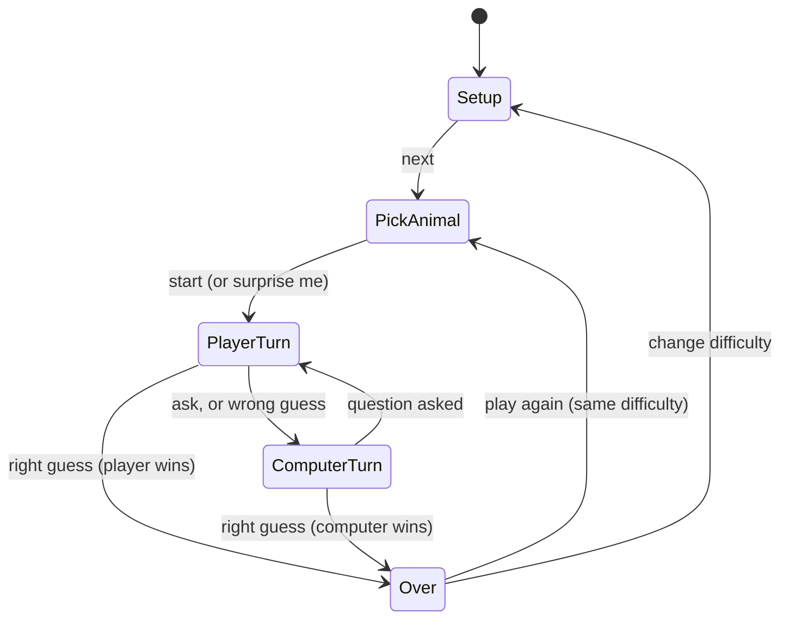

# Game spec

Status: draft for review · Owner: Medhini · Issue: #70 · Last updated: 2026-11-17

The rules, data format, computer opponent, interaction model and package API of the
game on `/play`. Every later game issue builds against this page. The concept, scope
and cut lines are decided in [ADR-0005](../adr/0005-deduction-game-with-board-packs.md);
the package boundaries in [ADR-0002](../adr/0002-monorepo-with-standalone-game-package.md).
The screens are in [`wireframes.md`](../design/wireframes.md#play-play).

## Decisions

Answers from the owner, and what is still open. "Proposed" means this spec suggests it
and the owner has not confirmed it.

| Topic | Decision | Status |
|---|---|---|
| Name | `PLACEHOLDER: game name`. Original; must not imitate "Guess Who?" (a third-party trademark) | Open |
| Art style | Pixel art, **AI-assisted drafts, then edited by the owner** | Decided; see [Art plan](#art-plan) |
| Animals | 24, all drawn from the start; Lion and Jellyfish replaced Gecko and Goldfish. The first 16 are the cut-line fallback ([ADR-0005](../adr/0005-deduction-game-with-board-packs.md)) | Decided |
| Questions | A fixed list of 68 yes/no questions in five groups, with a **type-to-filter** box. No free-text questions: the answers come from the board data | Decided |
| Ruled-out marks | Both: automatic, with manual override | Decided |
| A wrong guess | Loses the turn; the game goes on | Decided |
| Difficulty names | `PLACEHOLDER: easy name`, `PLACEHOLDER: medium name`, `PLACEHOLDER: hard name` (ids `easy`, `medium`, `hard`) | Open |
| Who starts | The player. A turn banner above the board says whose turn it is and what the computer just did | Decided |
| Your animal | The player picks it, or taps "Surprise me" for a random one. The computer's animal is random | Decided |
| Computer's board | The player can see the computer's own board: the animals it still thinks yours could be | Decided |
| Ruled-out look | The sprite is blurred in place and stays recognisable. The card does not move | Decided |
| Answers | The engine answers the computer's questions for the player, truthfully | Proposed |

## Rules and turn flow

**Setup.** The player chooses a difficulty, then picks their own secret animal, or taps
"Surprise me" for a random one. The engine picks the computer's secret animal at random.
The player always sees their own animal ("Your animal") and never the computer's. Both
sides play on the same 24 animals.

**A turn** is exactly one of these:

1. **Ask.** Pick one of the 68 yes/no questions you have not asked yet. The engine
   answers about the other side's secret animal. Cards that cannot match are marked as
   ruled out on your board (see [Ruled-out marks](#ruled-out-marks)).
2. **Guess.** Name one animal. If it is the other side's secret animal, you win. If
   not, the guess is wrong, you lose the turn, and that card is marked as ruled out.

Then the other side takes its turn. The player starts. Turns alternate until someone
guesses right.

**Winning and losing.** The first correct guess wins the game. A side that guesses right
on its turn wins; there is no draw. Questions cannot be asked twice by the same side,
and answers are always true: nobody bluffs.

**The computer** only guesses when one animal is left, so it never guesses wrong. Every
question it asks removes at least one animal, so it finishes within 24 of its turns at
any difficulty, and within 6 at `hard` (at most 5 questions, then the guess). The player
cannot stall the game: the computer keeps asking.

**First move.** The player starts, and the turn banner says so ("Your turn"). A side
that is as fast as the other wins if it starts, so this is a small advantage. This
matters little at the easier levels. Alternatives if it matters in play-testing: a random
first player, or "Play again" swaps who starts.



## Board pack schema

A board pack is a JSON file. The engine plays any valid pack and does not know what the
characters look like ([ADR-0005](../adr/0005-deduction-game-with-board-packs.md)).

```ts
/** A yes/no question about every character. Only booleans for now. */
interface Attribute {
  id: string; // 'fur'
  question: string; // 'Does it have fur or hair?'
  type: 'boolean';
}

/** One card on the board. */
interface Character {
  id: string; // 'tiger'
  name: string; // 'Tiger'
  sprite: string; // sprite reference; the UI resolves it (see Art plan)
  alt: string; // text alternative of the sprite
  values: Record<string, boolean>; // attribute id -> value
}

/** A complete set of characters and questions. */
interface BoardPack {
  id: string; // 'animals'
  name: string; // 'Animals'
  version: number; // the pack's own version, starting at 1
  attributes: Attribute[];
  characters: Character[];
}
```

**Validator rules** (`validateBoardPack`). It returns every problem it finds, not just
the first, each with a path and a code, and never throws on bad input:

1. `id`, `name` and `version` are present and well-typed.
2. Attribute ids are unique, and so are character ids.
3. Every attribute has a non-empty `question` and the type `boolean`.
4. Every character has a value for every attribute, and no values for unknown attributes.
5. Every character has a non-empty `name`, `sprite` and `alt`.
6. No two characters have identical values for all attributes.
7. Every attribute splits the board: at least one character answers yes and at least
   one answers no.
8. There are at least 2 characters and at least 1 attribute.

Rules 6 and 7 together are what make a board winnable by questions alone: every
animal can be told apart from every other.

**Cutting a board.** Removing characters can leave an attribute that no longer splits
the rest (for example "Does it have a trunk?" once the elephant is gone). The cut-line
16-animal pack is the same file with the 8 characters removed and the attributes that
no longer split deleted; it then passes rules 6 and 7 again.

## The animals board

68 yes/no questions in five groups and 24 animals. The answers below are a proposal for
the owner to review; the checks in rules 6 and 7 pass for all 24. The first 16 animals
are the cut-line board (see "Cutting a board" above).

### Questions

The questions are grouped as Type (9), Body (25), Looks (12), Habitat (8) and Behaviour
(14), and the player can filter them by group and by typing
([Asking and guessing](#asking-and-guessing)). Some point at one animal on purpose, such
as "Does it have a trunk?" or "Does it make honey?": 20 questions have exactly
one "yes". Most answers are plain; the last column explains the few that are not. "As
drawn" means the finished sprite decides, so the owner may flip a value if the art
differs.

| Id | Group | Question | Yes for | How to read it |
|---|---|---|---|---|
| `mammal` | Type | Is it a mammal? | Cat, Tiger, Zebra, Giraffe, Deer, Goat, Panda, Rabbit, Elephant, Lion, Dolphin, Bat |  |
| `bird` | Type | Is it a bird? | Penguin, Eagle, Parrot, Duck, Flamingo, Ostrich |  |
| `reptile` | Type | Is it a reptile? | Crocodile |  |
| `amphibian` | Type | Is it an amphibian? | Frog |  |
| `fish` | Type | Is it a fish? | Shark |  |
| `insect` | Type | Is it an insect? | Bee |  |
| `backbone` | Type | Does it have a backbone? | Cat, Tiger, Zebra, Giraffe, Deer, Goat, Panda, Penguin, Eagle, Parrot, Duck, Flamingo, Crocodile, Frog, Shark, Rabbit, Elephant, Ostrich, Lion, Dolphin, Bat | "No" means an invertebrate: bee, octopus and jellyfish. |
| `cold_blooded` | Type | Is it cold-blooded? | Crocodile, Frog, Shark, Bee, Jellyfish, Octopus | Its body temperature follows its surroundings. |
| `lays_eggs` | Type | Does it lay eggs? | Penguin, Eagle, Parrot, Duck, Flamingo, Crocodile, Frog, Bee, Ostrich, Jellyfish, Octopus | The great white shark gives birth to live young, so the shark is "no"; jellyfish release eggs. |
| `fur` | Body | Does it have fur or hair? | Cat, Tiger, Zebra, Giraffe, Deer, Goat, Panda, Rabbit, Lion, Bat | The elephant and dolphin are "no": too little hair to count. |
| `feathers` | Body | Does it have feathers? | Penguin, Eagle, Parrot, Duck, Flamingo, Ostrich |  |
| `scales` | Body | Does it have scales? | Crocodile, Shark | Shark skin counts. |
| `smooth_skin` | Body | Does it have smooth, bare skin? | Frog, Jellyfish, Dolphin, Octopus | No fur, feathers or scales. The elephant is "no": its skin is wrinkled. |
| `wings` | Body | Does it have wings? | Penguin, Eagle, Parrot, Duck, Flamingo, Bee, Ostrich, Bat | The penguin and ostrich have wings even though they cannot fly. |
| `four_legs` | Body | Does it have four legs? | Cat, Tiger, Zebra, Giraffe, Deer, Goat, Panda, Crocodile, Frog, Rabbit, Elephant, Lion | Counts legs, not how it moves. |
| `two_legs` | Body | Does it have exactly two legs? | Penguin, Eagle, Parrot, Duck, Flamingo, Ostrich, Bat |  |
| `six_legs` | Body | Does it have six legs? | Bee |  |
| `eight_arms` | Body | Does it have eight arms? | Octopus |  |
| `tail` | Body | Does it have a tail? | Cat, Tiger, Zebra, Giraffe, Deer, Goat, Panda, Penguin, Eagle, Parrot, Duck, Flamingo, Crocodile, Shark, Rabbit, Elephant, Ostrich, Lion, Dolphin, Bat | A fish tail and a dolphin fluke count. An adult frog has none. |
| `long_neck` | Body | Does it have a long neck? | Giraffe, Flamingo, Ostrich | The neck is clearly longer than the head. |
| `horns` | Body | Does it have horns or antlers? | Deer, Goat | Giraffe ossicones and elephant tusks do not count. |
| `hooves` | Body | Does it have hooves? | Zebra, Giraffe, Deer, Goat |  |
| `beard` | Body | Does it have a beard? | Goat |  |
| `mane` | Body | Does it have a mane? | Zebra, Lion |  |
| `trunk` | Body | Does it have a trunk? | Elephant |  |
| `tentacles` | Body | Does it have tentacles? | Jellyfish, Octopus | Arms with suckers or stinging threads. |
| `claws` | Body | Does it have sharp claws or talons? | Cat, Tiger, Eagle, Crocodile, Lion | Claws it uses to catch prey. |
| `whiskers` | Body | Does it have whiskers? | Cat, Tiger, Rabbit, Lion |  |
| `big_ears` | Body | Does it have big or long ears? | Rabbit, Elephant, Bat |  |
| `beak` | Body | Does it have a beak or bill? | Penguin, Eagle, Parrot, Duck, Flamingo, Ostrich | A beak you can see. |
| `hooked_beak` | Body | Does it have a hooked beak? | Eagle, Parrot |  |
| `fins_flippers` | Body | Does it have fins or flippers? | Penguin, Shark, Dolphin |  |
| `dorsal_fin` | Body | Does it have a fin on its back? | Shark, Dolphin |  |
| `gills` | Body | Does it breathe with gills? | Shark, Octopus | The jellyfish has none. |
| `stripes` | Looks | Does it have stripes? | Tiger, Zebra, Bee |  |
| `spots` | Looks | Does it have spots? | Giraffe |  |
| `black_white` | Looks | Is it mostly black and white? | Zebra, Panda, Penguin | As drawn. The ostrich is drawn brown and grey. |
| `orange_yellow` | Looks | Is it mostly orange, yellow or gold? | Tiger, Bee, Lion | As drawn. |
| `pink` | Looks | Is it pink? | Flamingo |  |
| `grey` | Looks | Is it mostly grey? | Shark, Elephant, Dolphin | As drawn. |
| `green` | Looks | Is it mostly green? | Crocodile, Frog | As drawn. |
| `colourful` | Looks | Is it very colourful, with three or more bright colours? | Parrot |  |
| `see_through` | Looks | Can you see through its body? | Jellyfish |  |
| `large` | Looks | Is it bigger than a large dog? | Tiger, Zebra, Giraffe, Deer, Goat, Panda, Crocodile, Shark, Elephant, Ostrich, Lion, Dolphin | Adult size, as drawn. |
| `tiny` | Looks | Is it small enough to sit on your hand? | Frog, Bee |  |
| `tall` | Looks | Is it taller than a grown-up person? | Giraffe, Elephant, Ostrich | Standing height. |
| `water` | Habitat | Does it live in or near water? | Penguin, Duck, Flamingo, Crocodile, Frog, Shark, Jellyfish, Dolphin, Octopus |  |
| `ocean` | Habitat | Does it live in the sea? | Penguin, Shark, Jellyfish, Dolphin, Octopus | The penguin spends most of its life at sea. |
| `freshwater` | Habitat | Does it live in a lake, river or pond? | Duck, Flamingo, Crocodile, Frog |  |
| `water_only` | Habitat | Does it spend its whole life in water? | Shark, Jellyfish, Dolphin, Octopus |  |
| `forest` | Habitat | Does it live in a forest? | Tiger, Deer, Panda, Parrot | Its main home. |
| `savanna` | Habitat | Does it live on grassland or savanna? | Zebra, Giraffe, Elephant, Ostrich, Lion | Its main home. |
| `cold` | Habitat | Does it live where there is snow and ice? | Penguin |  |
| `pet` | Habitat | Is it often kept as a pet? | Cat, Parrot, Rabbit |  |
| `flies` | Behaviour | Can it fly? | Eagle, Parrot, Duck, Flamingo, Bee, Bat |  |
| `hunts` | Behaviour | Does it hunt other animals? | Cat, Tiger, Penguin, Eagle, Crocodile, Frog, Shark, Lion, Jellyfish, Dolphin, Octopus, Bat | Catches other animals to eat. Grazers and filter feeders do not. |
| `plants` | Behaviour | Does it mostly eat plants? | Zebra, Giraffe, Deer, Goat, Panda, Parrot, Bee, Rabbit, Elephant, Ostrich | Grass, leaves, seeds, fruit or nectar. The panda eats bamboo. |
| `stings` | Behaviour | Can it sting? | Bee, Jellyfish |  |
| `honey` | Behaviour | Does it make honey? | Bee |  |
| `roars` | Behaviour | Does it roar? | Tiger, Lion |  |
| `purrs` | Behaviour | Does it purr? | Cat |  |
| `talks` | Behaviour | Can it copy human speech? | Parrot |  |
| `hops` | Behaviour | Does it hop? | Frog, Rabbit |  |
| `echo` | Behaviour | Does it find its way with echoes? | Dolphin, Bat | Echolocation. |
| `ink` | Behaviour | Can it squirt ink? | Octopus |  |
| `upside_down` | Behaviour | Does it sleep hanging upside down? | Bat |  |
| `one_leg` | Behaviour | Does it often stand on one leg? | Flamingo |  |
| `bamboo` | Behaviour | Does it eat bamboo? | Panda |  |

"Does it have a backbone?" covers vertebrate and invertebrate: "no" means invertebrate
(bee, octopus, jellyfish).

### Animals

A ✓ in the "16" column marks the first 16 (the cut-line board). Which animals answer
"yes" to which question is in the table above.

| # | Animal | 16 | Questions answered "yes" |
|--:|---|:-:|--:|
| 1 | Cat | ✓ | 10 |
| 2 | Tiger | ✓ | 13 |
| 3 | Zebra | ✓ | 12 |
| 4 | Giraffe | ✓ | 12 |
| 5 | Deer | ✓ | 10 |
| 6 | Goat | ✓ | 10 |
| 7 | Panda | ✓ | 10 |
| 8 | Penguin | ✓ | 14 |
| 9 | Eagle | ✓ | 12 |
| 10 | Parrot | ✓ | 15 |
| 11 | Duck | ✓ | 11 |
| 12 | Flamingo | ✓ | 14 |
| 13 | Crocodile | ✓ | 13 |
| 14 | Frog | ✓ | 12 |
| 15 | Shark | ✓ | 14 |
| 16 | Bee | ✓ | 12 |
| 17 | Rabbit |  | 10 |
| 18 | Elephant |  | 11 |
| 19 | Ostrich |  | 13 |
| 20 | Lion |  | 13 |
| 21 | Jellyfish |  | 10 |
| 22 | Dolphin |  | 13 |
| 23 | Octopus |  | 11 |
| 24 | Bat |  | 11 |

Properties of this board (checked by script when the spec was written):

- All 24 animals differ, and every question splits the board. The closest pair is Deer
  and Goat, which differ in 2 answers; no pair differs in just one.
- The most even questions split 12 and 12: mammal, bigger than a large dog, hunts, four
  legs. A perfect player (always the most even split) finds any animal in 4 or 5
  questions, 4.7 on average. On the 16-animal board it is always 4.
- Cutting to 16 removes 8 questions that no longer split (eight arms, trunk, tentacles,
  big ears, see-through, echoes, ink, upside down) and leaves 60.
- The computer at `hard` needs the same 4 or 5 questions. At `medium` it averages about 5.0
  and at `easy` about 5.6 (worst seen: 12).

Each animal's alt text starts as "Pixel art of a tiger." (with "an" before a vowel), and
the owner replaces it if the finished sprite shows more.

## Computer opponent

**Candidates.** The computer keeps a list of animals that could still be the player's
secret animal. Each true answer removes the ones that disagree.

**Choosing a question** (the best question): among the questions not yet asked, ignore
any where all remaining candidates give the same answer (it would tell nothing). For
each other question count the candidates that answer yes. Pick the one where that count
is closest to half of the candidates. Ties are broken at random with the game's seeded
random number generator. This is the maximum expected information of
[ADR-0005](../adr/0005-deduction-game-with-board-packs.md), for yes/no questions.

**Guessing.** When one candidate is left, the computer guesses it. Otherwise it asks.

**Difficulty** changes only how often the computer ignores the best question. With
probability `randomChance` per turn it picks a random useful question instead (still
never a useless one):

| Id | `randomChance` | Meaning |
|---|---|---|
| `easy` | 0.6 | Often asks a poor question |
| `medium` | 0.3 | Sometimes does |
| `hard` | 0 | Always the best question |

These are starting values to tune while play-testing; the names shown to the player are
`PLACEHOLDER: easy name`, `PLACEHOLDER: medium name`, `PLACEHOLDER: hard name`.
ADR-0005 allows a cut to two difficulties: drop `medium`.

**Fairness.** The computer reads only the answers it has been given, never the player's
animal or the player's marks.

**Pace.** The computer's turn waits at least half a second, so a screen reader finishes
announcing the player's turn first. Nothing is timed for the player (WCAG 2.2.1).

## Interaction and accessibility model

### Screens

1. **Start.** The title, a three-step "how to play", the difficulty choice, a line saying
   you take the first turn, and a "Next: pick your animal" button.
2. **Pick your animal.** The 24 animals as cards. Choosing one marks it ("your pick");
   "Start with the penguin" begins the game, "Surprise me" picks one at random and begins,
   and "Back" returns to Start. Before a pick, the main button reads "Pick an animal to
   start" and is switched off. The computer never sees the pick, only the answers.
3. **Turn.** A turn banner, your animal, your board, the computer's board, the
   questions and a log.
4. **End.** Who won, both secret animals, the turn count and what to do next: "Play
   again" (same difficulty, back to the pick step), "Change difficulty" (back to Start)
   and "Back to Home".

**Layout.** Start, Pick and End use the 736 px text column. Turn is wider (about 1000 px
on desktop): the banner and your animal across the top; on the left the mode buttons,
your board and the computer's board; on the right the questions and the game log. On a
phone everything is one column in the same order, and a "Your board / Computer's board"
tab switch shows one board at a time.

### The turn banner

A banner at the top of the Turn screen is the main signal of whose turn it is. It shows
"Your turn" (or "Computer's turn" while the computer thinks) and, below it, the last move
in full: "The computer asked: Does it have feathers? The answer is yes." On the first
turn it reads "You go first. Ask a question or make a guess." The banner is the game's
live region ([Announcements](#announcements)); the log keeps the history.

### The board

24 cards in a grid (6 columns on desktop, 4 on a phone). Each card is a button with the
sprite and the animal's name. Cards never move or change size: a ruled-out card stays in
its place. A card has one of these states, never shown by colour alone: normal,
**ruled out** (the sprite is blurred, about 2 px, and the card has a dashed border and
the words "ruled out"; the name stays sharp and keeps full contrast), and **focused**
(the accent focus ring). Sprites must stay recognisable when blurred (see the
[Art plan](#art-plan)).

### The computer's board

The player can see the computer's own board: the animals the computer still thinks your
animal could be, with the same blur for the ones it has ruled out. It is read-only, a
list of 24 entries ("Penguin, still in", "Frog, ruled out") and not a tab stop, with a
"3 of 24 still in" count. It shows only what the computer has been told by your answers,
so it never reveals more than the computer knows. On a phone it sits behind the
"Computer's board" tab.

### Ruled-out marks

- **Automatic.** After each answer, cards that cannot match are marked ruled out.
- **Manual.** The player can flip any card with Space or Enter (in Ask mode), or a tap.
  A manual choice always wins: automatic marks never overwrite it, and "Reset marks"
  clears every manual choice.
- The marks are the player's notes. They never change a rule: the engine accepts a
  guess at a ruled-out card.

### Asking and guessing

- **Ask.** The 68 questions as buttons in a scrolling list, grouped as Type, Body, Looks,
  Habitat and Behaviour. A question already asked stays in the list, disabled, with its
  answer ("Is it a mammal? Yes").
- **Filter.** A "Filter questions" text box above the list. Typing shows only the
  questions that contain every typed word (any order, ignoring case), and a count says
  "3 of 68 questions match". Group buttons (All, Type, Body, Looks, Habitat, Behaviour)
  narrow the list further. A clear button and Escape in the box empty it. Pressing Enter
  never asks a question; only a question button does. No match shows "No question
  matches. Clear the filter."; asked questions still match and stay disabled.
- **Guess.** A "Make a guess" button turns the board into guess mode: cards now read
  "Guess tiger". Choosing one opens a confirmation ("Guess tiger? Yes, guess / Cancel");
  nothing is guessed on a single press. Cancel returns to Ask mode.
- **Your animal** is shown in a small panel all the time.

### Keyboard

| Key | Where | Action |
|---|---|---|
| Tab / Shift+Tab | Everywhere | Moves between regions: mode buttons, board (one tab stop), filter, group buttons, question list, log |
| Arrow keys | Board | Move between cards, in the grid's rows and columns |
| Home / End | Board | First / last card in the row |
| Ctrl+Home / Ctrl+End | Board | First / last card |
| Space or Enter | A card | Ask mode: flip the mark. Guess mode: choose it for a guess |
| Space or Enter | A question | Ask it |
| Escape | Confirmation | Cancel the guess |
| Escape | Filter box | Clear the filter |

A "Skip to the questions" link comes before the board so keyboard and screen-reader
users do not have to pass 24 cards. There are no single-character shortcuts.

### Announcements

The turn banner is one polite live region (`role="status"`). It announces every game event
in order, and the log shows the same text:

- "You asked: Does it have fur or hair? The answer is yes. 10 of 24 animals are still in."
- "The computer asked: Can it fly? The answer is no."
- "Computer's turn." (when the player has asked or guessed wrong)
- "You guessed Tiger. That is not it. You lose this turn."
- "You won. The computer's animal was the tiger." (also moves focus to the result
  heading)
- "3 of 68 questions match legs." (from the filter box, as you type, after a short pause)

The "X of 24" count is also visible next to the board. Each card's name has the animal
and its state: "Tiger, ruled out".

### Focus

After asking, focus goes to the filter box (the question just asked is now disabled and
cannot hold focus). After a wrong guess, it goes to the turn banner. When the game ends
it goes to the result heading. Focus is never lost to the page body. When the guess
confirmation opens, focus starts on Cancel and returns to the card that was chosen.

### Other

- Every control is at least 44 px high ([`tokens.md`](../design/tokens.md#spacing-shape-and-focus));
  on a phone the cards are about 83 px wide.
- `prefers-reduced-motion` is honoured: marks and blur change instantly and nothing
  animates.
- The question list is a scrolling region of fixed height. It never traps focus, and the
  filter and group buttons let keyboard and screen-reader users avoid scrolling through
  68 buttons.
- Contrast and focus follow `tokens.md` in both themes. Sprites sit on `--game-surface`.
- The page works with the keyboard alone and on a 390 px phone, as the plan requires.

## Package API

The site imports the game only through `packages/game/src/index.ts`
([ADR-0002](../adr/0002-monorepo-with-standalone-game-package.md)). The package has no
routing, analytics or browser storage: it exposes callbacks and the site decides.

```ts
/** The game component, a React island on /play. */
export function Game(props: GameProps): ReactElement;

interface GameProps {
  pack?: BoardPack; // default: the animals board
  seed?: string | number; // fixes the random choices; default: random
  onGameStart?: (info: { difficulty: Difficulty; packId: string }) => void;
  onGameEnd?: (result: GameResult) => void;
}

type Difficulty = 'easy' | 'medium' | 'hard';

interface GameResult {
  winner: 'player' | 'computer';
  difficulty: Difficulty;
  packId: string;
  turns: number; // total turns, both sides
  questionsAsked: number; // by the player
  wrongGuesses: number; // by the player
}

/** Checks a board pack against the rules above. */
export function validateBoardPack(pack: unknown): ValidationResult;

interface ValidationResult {
  ok: boolean; // true when `errors` is empty
  errors: { path: string; code: string; message: string }[]; // 'characters[3].values.fur', 'missing_value'
}

export type { BoardPack, Attribute, Character, Difficulty, GameResult };
export { animalsBoard } from './boards';
```

The engine (`src/engine`) imports no React and no DOM, takes the random number
generator as a parameter, and is covered by tests ([below](#what-the-engine-tests-cover)).

**Theming.** The site sets these custom properties on the game's container; the game
reads nothing else from the site:

| Property | Set to |
|---|---|
| `--game-bg` | `--color-bg` |
| `--game-surface` | `--color-surface` |
| `--game-text` | `--color-text` |
| `--game-muted` | `--color-muted` |
| `--game-accent` | `--color-accent` |
| `--game-on-accent` | `--color-on-accent` |
| `--game-highlight` | `--color-highlight` |
| `--game-font-heading` | `--font-pixel` |
| `--game-font-body` | `--font-body` |
| `--game-radius` | `--radius` |

The playground (`pnpm --filter game dev`) sets the same names to defaults, so the game
runs without the site.

## Art plan

- **Style.** Pixel art, one sprite per animal, drawn on a 32 × 32 grid and shown at whole
  multiples of the grid (1×, 2×, 3× or 4×, so the edges stay crisp): 2× (64 px) on the
  boards, 1× (32 px) on the computer's board, larger on the Pick and End screens. One shared palette of at most 16 colours, and a 1 px
  outline in `--game-text`, so sprites read in light and dark.
- **Format.** One SVG file per animal, made of square pixels, in
  `packages/game/src/boards/animals/sprites/<id>.svg`. The pack's `sprite` field is the
  file name without `.svg`.
- **Process.** Drafts may be made with an AI image tool and are then redrawn or edited
  by the owner on the pixel grid. The finished sprite is the owner's. This is a
  decision about how the art is made, so it is recorded in
  [ADR-0012](../adr/0012-game-art-is-ai-assisted-pixel-art-edited-by-the-owner.md), and
  the tool used goes into [`ai-usage.md`](../ai-usage.md) once it is chosen.
- **Checklist for each sprite.** Original (not copied from or imitating an existing
  character or brand, as ADR-0005 requires); the tool's terms allow the use; readable
  at 64 px wide; still recognisable with a 2 px blur (the ruled-out look) and at 32 px
  (the computer's board); alt text agreed; added to the pack; listed in the pull request.
- **Licence.** Content and artwork are all rights reserved
  ([`CONTENT-LICENSE.md`](../../CONTENT-LICENSE.md)).

## What the engine tests cover

A guide for the engine issues, not an exhaustive list:

- The validator: each rule in the list has a failing and a passing example, and several
  problems in one pack are all reported.
- The animals board passes the validator, for all 24, and for the first 16 once the
  questions that no longer split are removed (the cut-line rule).
- Answers are always true, and candidates only ever shrink.
- The best question picks the closest-to-half split, and ties follow the seed.
- `hard` never asks a useless question; `easy` sometimes asks a poorer one than the best.
- A game against any animal ends within 24 computer turns at every difficulty, and within
  6 at `hard`.
- A wrong guess loses the turn and marks that card; a right guess ends the game.
- Turn order: the player starts, and turns alternate.
- The player's pick is the animal the engine answers about; "Surprise me" picks any of the
  24 and follows the seed; the computer never reads the pick.
- The computer's candidate list matches what it was told, and only shrinks.
- The question filter: every typed word must match, order and case do not matter, an empty
  filter shows all 68, and asked questions still match.

## Not in this spec

Multiplayer, accounts, saved progress, leaderboards and prompt-generated boards are
non-goals ([`plan.md`](../plan.md#non-goals)). Ideas go to
[`parking-lot.md`](../parking-lot.md).

## Open questions

1. The game's name, the one-line pitch and the three difficulty names.
2. Are the 68 questions and 24 animals right? Check the "Yes for" column and the
   "How to read it" notes, change a value or swap an animal, then re-run the checks in
   [the animals board](#the-animals-board).
3. Which AI image tool the drafts come from, and its terms.
4. Wording of the art credit line on the game page.
